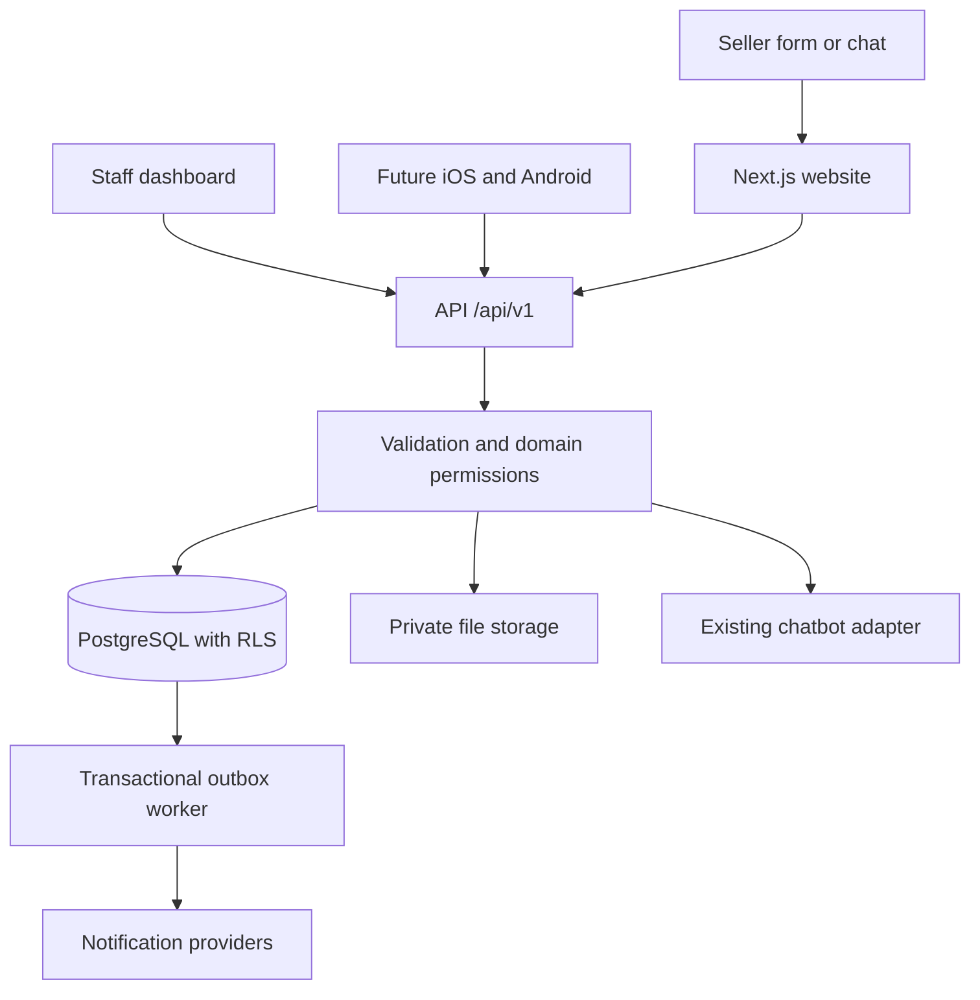

# Architecture and environments

## Stack and boundaries

Use Next.js App Router with TypeScript/React, server rendering for public content and server-side authorization for staff pages. Use client components for forms, chat and interactive controls. Tailwind must match the reference instead of substituting a generic template.

Supabase PostgreSQL is the source of truth. Use Supabase Auth for invite-only staff and private Storage for vehicle photos/attachments. SQL migrations are the only schema authority. Generate DB types after migrations. Multi-record writes use a reviewed transactional repository/RPC, not separate best-effort inserts.

Select and pin compatible stable Next.js/React/Node/pnpm versions at bootstrap. The parent furniture app's Next.js 16.2.12 is not this app's baseline. Verify the chosen version and read its bundled guides before code changes.



Route Handlers expose the contract. Server-rendered pages may call the same services directly. Server Actions are optional conveniences, not the only implementation of mobile-required operations.

## Planned structure

```text
apps/web/src/app/       # marketing, dashboard, API, authenticated previews
apps/web/src/components/
apps/web/src/server/    # framework/session adapters
apps/web/public/        # approved public assets only
apps/mobile/           # create during mobile phase
packages/contracts/    # DTOs, Zod, OpenAPI, typed client
packages/domain/       # lead rules, authorization, business interfaces
packages/database/     # repositories and generated types
packages/config/       # environment schema and business identity
supabase/migrations/
supabase/tests/
supabase/seed.sql       # fictional records only
content/               # structured content and publication manifest
reference/             # sanitized fixtures, not served publicly
tests/
docs/
.github/workflows/     # implement in infrastructure phase
```

Use pnpm workspaces. Add Turborepo only if multiple executable apps justify it. Share schemas/business logic with mobile first; UI reuse is optional. Move the current static fixture into `reference/` during migration and set the Vercel build root to `apps/web` with workspace access.

## Environment contract

| Environment | Git source | Origin | Data/auth | Notifications |
| --- | --- | --- | --- | --- |
| Local | local `dev` work | localhost | Local Supabase or isolated dev project | Fake provider/test inbox |
| Development | approved `dev` push | `https://dev.usjunkcars.si` | Dedicated dev Supabase | Test recipients only |
| Production | approved `main` release | `https://usjunkcars.si` | Dedicated production Supabase | Approved real providers |

Suggested Vercel projects: `usjunkcar-dev`, `usjunkcar-prod`. Both use their own Vercel production deployment context for a stable domain. The dev project's CLI `--prod` is still the business development environment. Hard-code branch→GitHub environment→project mapping; never select targets from arbitrary workflow inputs.

Set `APP_ENV=development` on the dev project independently of Vercel labels. Validate site origin, database project and environment together at startup. Use host-only cookies and separate auth callbacks; no shared `.usjunkcars.si` staff cookie. Generate absolute URLs from validated config, not the request Host header.

## Configuration names (no secret values)

| Setting | Scope | Purpose |
| --- | --- | --- |
| `APP_ENV`, `SITE_URL` | Server | Environment/origin guard |
| `NEXT_PUBLIC_SITE_URL` | Public, only if needed | Must equal configured origin |
| `NEXT_PUBLIC_SUPABASE_URL`, `NEXT_PUBLIC_SUPABASE_PUBLISHABLE_KEY` | Public | Environment-specific auth client; not authorization |
| `SUPABASE_SECRET_KEY` | Server only | Narrow intake/worker use, never bypass staff permissions |
| Migration connection credential | Protected CI secret | Schema deployment |
| Bot provider/key/webhook secret | Server only | Existing-bot adapter |
| Mail provider key, `MAIL_FROM`, test allowlist | Server only | Notifications/invitations |
| Upload and anti-abuse settings | Server, except approved widget key | Input protection |
| Redacted telemetry configuration | Per provider | Error/performance reporting |
| Vercel org/project IDs and pinned CLI version | CI variables per environment | Fixed deployment target |
| Vercel token and automation bypass secret | CI secrets per environment | Deploy/test only |

Create a names-only `.env.example` during bootstrap. Enter credentials in provider/CI settings, never docs/chat or Git.

## Domain migration

Replace reference values in navigation, CTAs, submissions, search, metadata/schema, sitemap, robots, business emails, callback URLs, CORS, webhooks, notifications and mobile deep links. Use relative internal URLs plus configured metadata origins. Canonical is the apex `usjunkcars.si`; redirect `www` only after DNS ownership is configured.

Keep source URLs in research citations/reference fixtures. Add a test prohibiting `usjunkcars.com`, the source phone and inherited company identity in production output. Unknown business identity must block launch rather than send leads to the original operator. Provider-owned video can remain only if approved.

## Reliability

Persist lead, consent, event and outbox together. Workers atomically claim jobs, retry with bounded backoff and expose dead-letter/retry status to admins. HTTP success means saved, not email delivered. Verify provider signatures and reject replayed callbacks. Align function/DB regions and use a suitable pool.

## Sources

[Next.js App Router](https://nextjs.org/docs/app) provides the framework model. [Supabase SSR](https://supabase.com/docs/guides/auth/server-side) describes cookie-based server sessions. These project boundaries are recommendations; verify current APIs when implementing.
