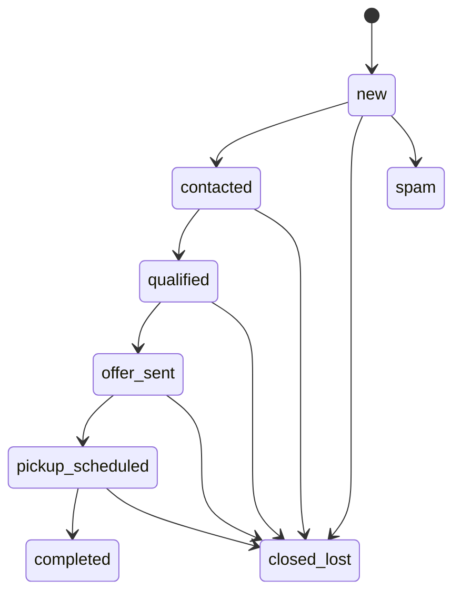

# API, lead lifecycle and staff dashboard

## Versioned contract

Base URL: `https://usjunkcars.si/api/v1`; development uses `https://dev.usjunkcars.si/api/v1`. OpenAPI and shared Zod DTOs must match. Do not expose SQL rows as the public schema. Use ISO timestamps, opaque IDs, integer money, typed enums, bounded strings and cursor pagination. Breaking changes get a new API version; old mobile clients remain supported for a documented migration window.

Success shape: `{ data, meta: { requestId, nextCursor? } }`. Error shape: `{ error: { code, message, fieldErrors?, retryable }, requestId }`. Never return stack traces or SQL details. Use 201 for created, 400/422 for invalid input, 401/403 for auth/permission, 404 for unavailable resource, 409 for version/idempotency conflict, 429 with Retry-After for limits and 503 for temporary dependency failures.

## Endpoint inventory

| Endpoint | Access | Contract |
| --- | --- | --- |
| `POST /leads` | Public, abuse-checked | Validated intake, Idempotency-Key required, transaction; return reference and scoped receipt only |
| `POST /contact-requests` | Public, abuse-checked | Durable contact request, consent and outbox transaction; idempotency required; no vehicle required |
| `GET /contact-requests`, `PATCH /contact-requests/:id` | Authorized staff | Assignment-scoped inbox; validated status/assignee changes with version checks and audit |
| `POST /contact-requests/:id/convert` | Authorized staff | Explicit conversion with vehicle intake validation; atomically create/link a lead; idempotent |
| `GET /service-areas?q=` | Public | Only approved coverage; no draft route/content leak |
| `POST /upload-sessions` | Scoped intake session or staff | Bounded upload authorization; no arbitrary storage keys |
| `POST /uploads/:id/complete` | Same scoped session/staff | Verify object, size/type and link ownership |
| `GET /leads` | Staff | Permission-scoped search/filter/pagination; no public enumeration |
| `GET /leads/:id` | Authorized staff | Lead detail and scoped related data |
| `PATCH /leads/:id` | Authorized staff | Allowed fields, expected version, audit event |
| `POST /leads/:id/transitions` | Authorized staff | Explicit transition, reason, expected version |
| `POST /leads/:id/assignments` | Manager/admin/owner | Check membership, reassignment audit |
| `POST /leads/:id/notes` | Authorized staff | Validated note and event |
| `POST /leads/:id/tasks` | Authorized staff | Follow-up task, assignee and due time |
| `POST /leads/:id/offers` | Staff with role-specific approval | Draft/propose or approve according to role; no implied seller acceptance |
| `POST /leads/:id/appointments` | Authorized staff | Valid slot/timezone, confirmation evidence |
| `GET /dashboard/metrics` | Staff | Permission-scoped aggregates and date range |
| `POST /exports` | Explicit export permission | Audited async CSV, short-lived private download, formula-injection escaping |
| `POST /chat/sessions` | Public, rate-limited | Opaque scoped session credential; no global conversation access |
| `POST /chat/sessions/:id/messages` | Session owner | Streaming response; disconnect-safe persistence and rate limits |
| `POST /chat/sessions/:id/handoff` | Session owner/staff | Durable staff handoff, no false availability promises |
| `POST /webhooks/:provider` | Verified provider | Signature, timestamp, replay/deduplication guard |
| `GET /health` | Public minimal | Service readiness only, no secrets or internal topology |
| `POST /devices`, `DELETE /devices/:id` | Authenticated mobile user | Mobile phase; token registration/revocation |

Authentication endpoints use the selected Supabase flow, not an invented password service. User-facing public lead tracking is optional later and requires an expiring unguessable credential or verified identity; a reference number alone is not authorization.

## Intake flow

1. Vehicle: year/make/model, condition, running state and title status; accept “unknown” rather than forcing fictional data.
2. Location: ZIP and approved coverage resolution; full address only if needed for pickup.
3. Contact: name, usable phone, optional email, preference and explicit consent with text version.
4. Optional photos. Explain validation failures without losing completed steps.
5. Review and submit with an idempotency key stable across retries for this attempt. The same key with a different payload returns a conflict.
6. Commit data transaction. Return a safe reference and an accurate next step; do not promise a dollar offer or pickup time unless actually approved.
7. Notify staff asynchronously; expose failure/retry in operations. A mail failure cannot erase an accepted lead.

Attribution uses first and last touch with bounded UTM/campaign values and a canonical landing path. Separate optional marketing consent from permission needed for the requested service. Avoid persisting phone/VIN/form PII in localStorage; if cross-device resume is later needed, use an expiring server session and explicit user expectations.

## Lifecycle

Transition requirements: contacted requires a recorded attempt/outcome; qualified requires required vehicle/location fields; offer_sent requires an approved offer and sending event; pickup_scheduled requires accepted offer/explicit confirmation, timezone and slot; completed requires pickup completion evidence. Closing requires a reason. Managers may correct/reopen with a reason and event; never rewrite history. Duplicate is a flag/link, not an automatic terminal state. Offer and appointment sub-lifecycles are separate from the lead stage.

Use optimistic concurrency (`version`/If-Match). Two agents editing the same lead must see a conflict/reload prompt rather than silently overwrite each other. A user's role or ownership changing during a session must take effect on the next action.

## Dashboard screens

| Screen | Required behavior |
| --- | --- |
| Overview | New/unassigned/stale leads, conversion funnel, source and response-time metrics |
| Lead list | Search, stage/source/location/assignee/date filters, sorting and cursor pagination |
| Board | Stage columns; moving cards calls the same validated transition service |
| Lead detail | Contact/vehicle/location, consent, attribution, notes, files, chat, offers and timeline |
| Tasks | Due/overdue, assignee, completed state and reminders |
| Contact inbox | General inquiries, assignment, response and resolution; explicit conversion to a vehicle lead |
| Pickup schedule | Day/week view, timezone, status and reschedule history |
| Conversations | Transcript, bot summary clearly marked, human takeover and resolution |
| Reports | Date filters, counts, conversion and source attribution; explicit denominators |
| Content preview | Page-family gallery, draft/review states, visual comparison; no one-click public release |
| Settings/team | Invites, roles, coverage, approved contact details and integration health |
| Operations | Failed jobs, webhook processing, retry history and environment badge |

Metrics definitions: accepted leads exclude spam/test records and unconverted general contact requests; response time is first recorded human contact minus creation; stage conversion uses a stated cohort/date window; completed rate is completed divided by accepted cohort leads; source is the selected attribution model. Never combine dev traffic with production reports.

Provide responsive tablet/phone layouts, keyboard alternatives to drag/drop, empty/loading/error states and safe confirmation for bulk changes/exports. Display an obvious development environment badge in the staff app. Avoid logging contact details in analytics or error reports.
